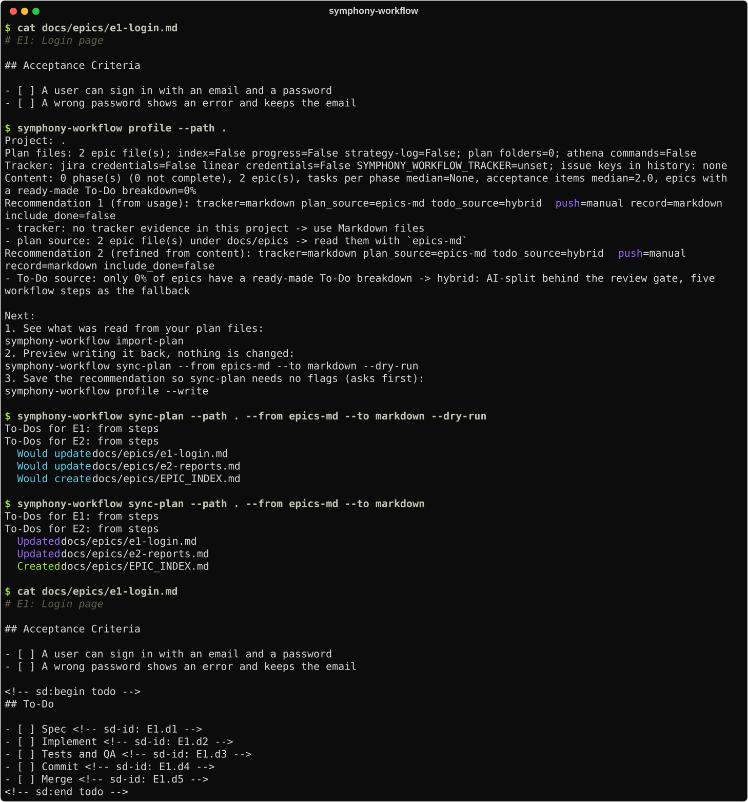
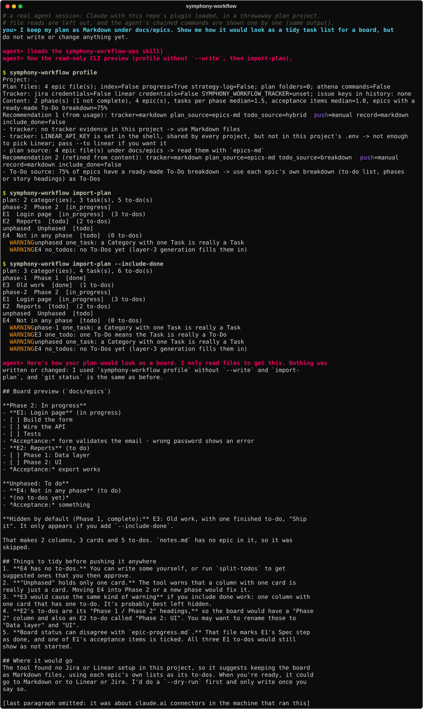
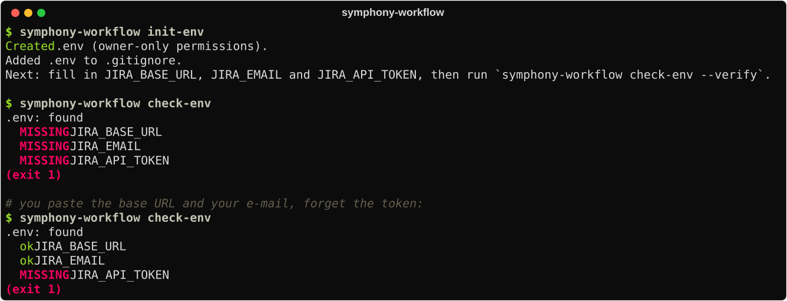
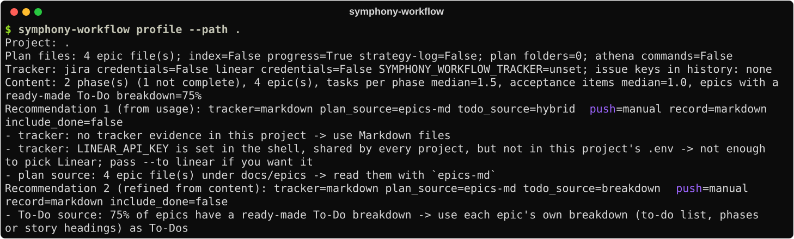
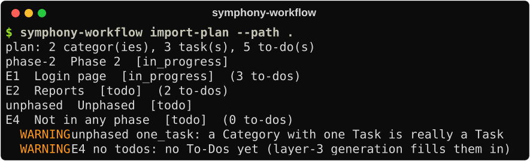
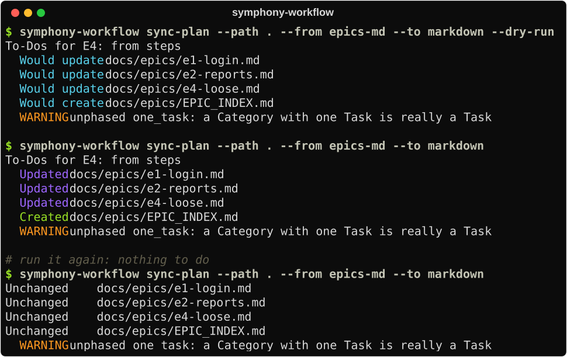
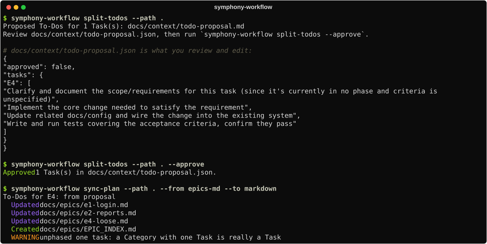
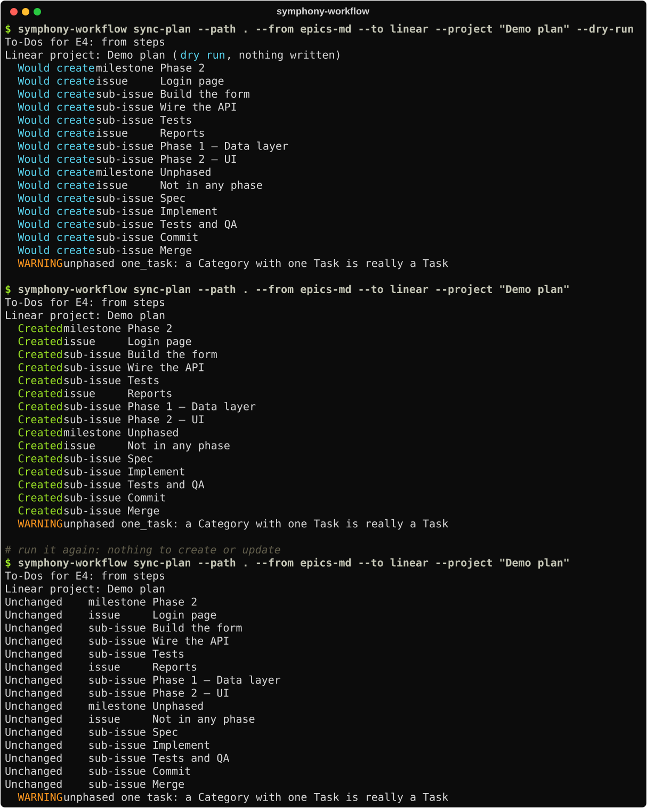
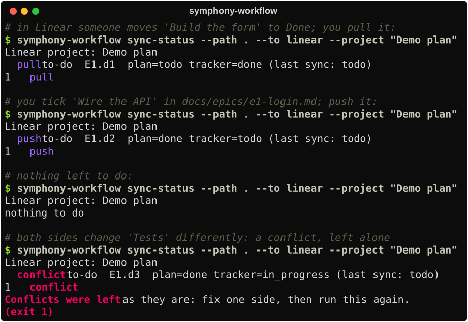
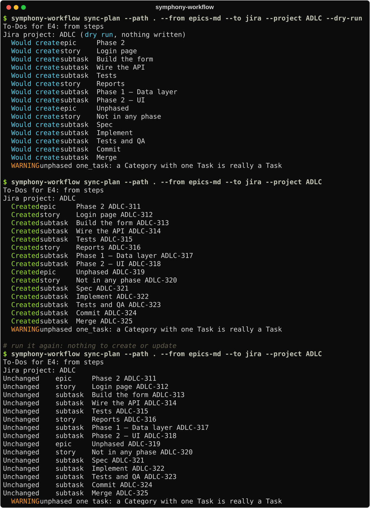

# symphony-workflow

[English](README.md) · [繁體中文](README.zh-TW.md)

[](https://github.com/cloud-f1/symphony-workflow/actions/workflows/ci.yml)
[](LICENSE)
[](pyproject.toml)
[](https://github.com/cloud-f1/symphony-workflow/tags)
[](#use-it-with-your-agent)
[](#what-the-agent-runs)

**Keep your plan in Markdown, and put it on a Linear or Jira board when you want one.** symphony-workflow is a
command-line tool plus a Claude Code plugin (three skills, two hooks). You write the work down as plain Markdown files;
you or your AI agent run it to preview the plan, push it to **Linear** or **Jira**, keep the status the same on both
sides, and take each ticket from a branch to a merged pull request and a release.

It never deletes anything, never writes to a tracker until you say so, and every write has a `--dry-run`.

## In one minute

| Word | What it means here |
|---|---|
| **Plan** | One Markdown file per piece of work, in `docs/epics/`. The tool reads them; the text stays yours. |
| **Category, Task, To-Do** | The three layers of a plan: a group of work (a phase), one piece of work (an epic file), and a step inside it (a checkbox). On Jira they become Epic, Story and Subtask; on Linear a milestone, an issue and a sub-issue. |
| **Tracker** | The board: Jira or Linear. Optional. With none, the plan simply stays as Markdown files. |
| **Plan sync** | Writing the plan to a tracker (or back to Markdown) and keeping the status the same on both sides. Running it again never makes duplicates. |
| **Agent** | An AI assistant such as Claude Code. It uses this tool through the plugin's skills, so you can ask for what you want in plain words. |

## Before you start

| You need | For | How to get it |
|---|---|---|
| [`uv`](https://docs.astral.sh/uv/) | installing and running the CLI (it brings Python 3.11 or newer) | the install page of uv |
| Claude Code | the plugin and its skills (the CLI works without it) | claude.com/claude-code |
| A Jira API token or a Linear API key | **only** to push to a board; previews and Markdown need no account | Atlassian account settings, Security, API tokens; a personal API key in your Linear settings |
| `git` and `gh` | the git loop (`start`, `pr`, `land`, `release`) | `gh auth login` once |

## Who it is for

- **You keep your plan as Markdown** (a `docs/epics/e1-...md` file per epic, the way an Athena-style workflow does) and
  want it on a board without retyping it, and without the two drifting apart.
- **You work Jira or Linear tickets with an agent** (Claude Code, Codex, a cron job) and want it to read, plan and move
  tickets through named tools instead of raw HTTP.
- **You are fixing a Jira project** whose Stories have no Subtasks, or whose parents never close.

## Your first plan file

Five minutes, no account, nothing leaves your machine. This is real output from a clean folder.

1. **Write one file per piece of work.** The file name starts with `e` and a number (`e1-login.md`), the first line is
   `# E1: Title`, and what must be true when it is done goes under `## Acceptance Criteria` as `- [ ]` items.
2. **Run `profile`.** It only reads. It says what it found, recommends a setup, and ends with a `Next:` list of the
   commands to run.
3. **Preview, then write.** `sync-plan --dry-run` shows what would change; without `--dry-run` it adds a To-Do list to
   each file. The list sits between two `sd:` marker comments, which is the only part the tool ever rewrites: your own
   text is left alone, and running it again changes nothing.



<details>
<summary>Text</summary>

<!-- snapshot: docs/snapshots/10-first-plan.txt -->
```text
$ cat docs/epics/e1-login.md
# E1: Login page

## Acceptance Criteria

- [ ] A user can sign in with an email and a password
- [ ] A wrong password shows an error and keeps the email

$ symphony-workflow profile --path .
Project: .
Plan files: 2 epic file(s); index=False progress=False strategy-log=False; plan folders=0; athena commands=False
Tracker: jira credentials=False linear credentials=False SYMPHONY_WORKFLOW_TRACKER=unset; issue keys in history: none
Content: 0 phase(s) (0 not complete), 2 epic(s), tasks per phase median=None, acceptance items median=2.0, epics with a ready-made To-Do breakdown=0%
Recommendation 1 (from usage): tracker=markdown plan_source=epics-md todo_source=hybrid push=manual record=markdown include_done=false
  - tracker: no tracker evidence in this project -> use Markdown files
  - plan source: 2 epic file(s) under docs/epics -> read them with `epics-md`
Recommendation 2 (refined from content): tracker=markdown plan_source=epics-md todo_source=hybrid push=manual record=markdown include_done=false
  - To-Do source: only 0% of epics have a ready-made To-Do breakdown -> hybrid: AI-split behind the review gate, five workflow steps as the fallback

Next:
  1. See what was read from your plan files:
       symphony-workflow import-plan
  2. Preview writing it back, nothing is changed:
       symphony-workflow sync-plan --from epics-md --to markdown --dry-run
  3. Save the recommendation so sync-plan needs no flags (asks first):
       symphony-workflow profile --write

$ symphony-workflow sync-plan --path . --from epics-md --to markdown --dry-run
  To-Dos for E1: from steps
  To-Dos for E2: from steps
  Would update docs/epics/e1-login.md
  Would update docs/epics/e2-reports.md
  Would create docs/epics/EPIC_INDEX.md

$ symphony-workflow sync-plan --path . --from epics-md --to markdown
  To-Dos for E1: from steps
  To-Dos for E2: from steps
  Updated      docs/epics/e1-login.md
  Updated      docs/epics/e2-reports.md
  Created      docs/epics/EPIC_INDEX.md

$ cat docs/epics/e1-login.md
# E1: Login page

## Acceptance Criteria

- [ ] A user can sign in with an email and a password
- [ ] A wrong password shows an error and keeps the email

<!-- sd:begin todo -->
## To-Do

- [ ] Spec <!-- sd-id: E1.d1 -->
- [ ] Implement <!-- sd-id: E1.d2 -->
- [ ] Tests and QA <!-- sd-id: E1.d3 -->
- [ ] Commit <!-- sd-id: E1.d4 -->
- [ ] Merge <!-- sd-id: E1.d5 -->
<!-- sd:end todo -->
```

</details>

The five To-Dos are the steps every piece of work goes through (spec, implement, test, commit, merge). Tick a box in the
file when a step is done. When you want the plan on a board, jump to [Push the plan to Linear](#5-push-the-plan-to-linear)
or [to Jira](#7-push-the-plan-to-jira); when a task needs its own steps instead of these five, see
[Let the agent propose the To-Dos](#4-let-the-agent-propose-the-to-dos-you-approve-them).

## Use it with your agent

**1. Install the plugin** in Claude Code (three skills and two hooks):

```text
/plugin marketplace add cloud-f1/symphony-workflow
/plugin install symphony-workflow-ops --marketplace cloud-f1/symphony-workflow
```

**2. Install the CLI the skills call.** The plugin does not ship it:

```bash
uv tool install git+https://github.com/cloud-f1/symphony-workflow
```

**3. Say what you want.** The skill triggers on plan and board requests; you do not have to name a command.

### What the agent gets

| | What it is | Covers |
|---|---|---|
| Skill `symphony-workflow-ops` | how to run the tool | plan sync (Markdown, Linear, Jira), the Plan/Implement loop, releasing, the git and PR gotchas |
| Skill `shipping` | how a ticket's code ships | branch from a ticket, commit and PR conventions, merge cleanup, releases with a changelog and a GitHub Release |
| Skill `jira-ticket-ops` | how to touch Jira safely | per-project credentials, hierarchy audit, Sub-tasks, rollup, a throwaway test tree |
| Commit hook | keeps the ticket key on commits | on a branch named for a ticket, a `git commit -m` whose subject lacks the key is blocked; silent on every other branch |
| SessionStart hook | a health check | checks the local API server when a symphony-workflow checkout is open, silent everywhere else |
| Tool calls | `list-tools` and `call` | every Jira operation as a JSON-schema tool, for an agent that is not Claude Code |

### Things to say

| You say | The agent does | Writes anything? |
|---|---|---|
| "Show my `docs/epics` plan as a board, change nothing" | reads the project, previews it | no |
| "Which tasks have no To-Dos? Propose some" | one read-only agent turn into a proposal file you edit and approve | only that file |
| "Put this plan on Linear as project Q4, dry run first" | a dry run, then the real run after your go-ahead | Linear, when you say so |
| "Same for Jira project KEY" | a dry run, then the real run | Jira, when you say so |
| "Keep the board in step with my checklist" | pulls changes from the board, pushes ticked To-Dos | checkboxes, cards; a conflict is reported and left alone |
| "Audit my Jira project's Stories and Sub-tasks" | audits, proposes Sub-tasks, rolls finished ones up | tickets, after your go-ahead |
| "Work ticket KEY-12: plan it, I will review" | the Plan phase for that ticket, then waits | no code until you approve |
| "Start working on KEY-12" | a branch named `KEY-12-...` and a worktree from a fresh `main`; the card moves to In Progress | a local branch, the card |
| "Open a PR for KEY-12" | pushes the branch, opens the PR with the key in its title; the card moves to In Review | the PR, the card |
| "KEY-12 is merged, clean up" | checks on GitHub that it merged, then removes the branch and worktree; the card goes Done | local and remote branches, the card |
| "Release 0.4.0" | the release checks, the tag, and a GitHub Release with the changelog as its note | a tag, a Release |

### A real session

This is a real run, not a mock-up: a Claude agent with this plugin loaded, working in a throwaway plan project. It
loaded the skill, read the project, ran the read-only commands, and wrote nothing (`git status` was the same before and
after). The first time I ran it the skill did not trigger at all, because its description did not mention Markdown plans;
the description was widened and the run repeated.



<details>
<summary>Text version of this session</summary>

<!-- snapshot: docs/snapshots/09-agent.txt -->
```text
# a real agent session: Claude with this repo's plugin loaded, in a throwaway plan project.
# file reads are left out, and the agent's chained commands are shown one by one (same output).
you> I keep my plan as Markdown under docs/epics. Show me how it would look as a tidy task list for a board, but
     do not write or change anything yet.

agent> [loads the symphony-workflow-ops skill]
agent> Now the read-only CLI preview (profile without `--write`, then import-plan).

$ symphony-workflow profile
Project: .
Plan files: 4 epic file(s); index=False progress=True strategy-log=False; plan folders=0; athena commands=False
Tracker: jira credentials=False linear credentials=False SYMPHONY_WORKFLOW_TRACKER=unset; issue keys in history: none
Content: 2 phase(s) (1 not complete), 4 epic(s), tasks per phase median=1.5, acceptance items median=1.0, epics with a ready-made To-Do breakdown=75%
Recommendation 1 (from usage): tracker=markdown plan_source=epics-md todo_source=hybrid push=manual record=markdown include_done=false
  - tracker: no tracker evidence in this project -> use Markdown files
  - tracker: LINEAR_API_KEY is set in the shell, shared by every project, but not in this project's .env -> not enough to pick Linear; pass --to linear if you want it
  - plan source: 4 epic file(s) under docs/epics -> read them with `epics-md`
Recommendation 2 (refined from content): tracker=markdown plan_source=epics-md todo_source=breakdown push=manual record=markdown include_done=false
  - To-Do source: 75% of epics have a ready-made To-Do breakdown -> use each epic's own breakdown (to-do list, phases or story headings) as To-Dos

$ symphony-workflow import-plan
plan: 2 categor(ies), 3 task(s), 5 to-do(s)
  phase-2  Phase 2  [in_progress]
    E1  Login page  [in_progress]  (3 to-dos)
    E2  Reports  [todo]  (2 to-dos)
  unphased  Unphased  [todo]
    E4  Not in any phase  [todo]  (0 to-dos)
  WARNING unphased one_task: a Category with one Task is really a Task
  WARNING E4 no_todos: no To-Dos yet (layer-3 generation fills them in)

$ symphony-workflow import-plan --include-done
plan: 3 categor(ies), 4 task(s), 6 to-do(s)
  phase-1  Phase 1  [done]
    E3  Old work  [done]  (1 to-dos)
  phase-2  Phase 2  [in_progress]
    E1  Login page  [in_progress]  (3 to-dos)
    E2  Reports  [todo]  (2 to-dos)
  unphased  Unphased  [todo]
    E4  Not in any phase  [todo]  (0 to-dos)
  WARNING phase-1 one_task: a Category with one Task is really a Task
  WARNING E3 one_todo: one To-Do means the Task is really a To-Do
  WARNING unphased one_task: a Category with one Task is really a Task
  WARNING E4 no_todos: no To-Dos yet (layer-3 generation fills them in)

agent> Here's how your plan would look as a board. I only read files to get this. Nothing was
       written or changed: I used `symphony-workflow profile` without `--write` and `import-
       plan`, and `git status` is the same as before.

       ## Board preview (`docs/epics`)

       **Phase 2: In progress**
       - **E1: Login page** (in progress)
         - [ ] Build the form
         - [ ] Wire the API
         - [ ] Tests
         - *Acceptance:* form validates the email · wrong password shows an error
       - **E2: Reports** (to do)
         - [ ] Phase 1: Data layer
         - [ ] Phase 2: UI
         - *Acceptance:* export works

       **Unphased: To do**
       - **E4: Not in any phase** (to do)
         - *(no to-dos yet)*
         - *Acceptance:* something

       **Hidden by default (Phase 1, complete):** E3: Old work, with one finished to-do, "Ship
       it". It only appears if you add `--include-done`.

       That makes 2 columns, 3 cards and 5 to-dos. `notes.md` has no epic in it, so it was
       skipped.

       ## Things to tidy before pushing it anywhere
       1. **E4 has no to-dos.** You can write some yourself, or run `split-todos` to get
          suggested ones that you then approve.
       2. **"Unphased" holds only one card.** The tool warns that a column with one card is
          really just a card. Moving E4 into Phase 2 or a new phase would fix it.
       3. **E3 would cause the same kind of warning** if you include done work: one column with
          one card that has one to-do. It's probably best left hidden.
       4. **E2's to-dos are its "Phase 1 / Phase 2" headings,** so the board would have a "Phase
          2" column and also an E2 to-do called "Phase 2: UI". You may want to rename those to
          "Data layer" and "UI".
       5. **Board status can disagree with `epic-progress.md`.** That file marks E1's Spec step
          as done, and one of E1's acceptance items is ticked. All three E1 to-dos would still
          show as not started.

       ## Where it would go
       The tool found no Jira or Linear setup in this project, so it suggests keeping the board
       as Markdown files, using each epic's own lists as its to-dos. When you're ready, it could
       go to Markdown or to Linear or Jira. I'd do a `--dry-run` first and only write once you
       say so.

       [last paragraph omitted: it was about claude.ai connectors in the machine that ran this]
```

</details>

## What the agent runs

Each picture below is what the agent ran for one of those requests, captured from a real run on a throwaway project
(and, for Linear and Jira, a throwaway board that was deleted afterwards). The text is under each picture, and in
`docs/snapshots/`.

### 1. Check the credentials without a token ever reaching the chat

`init-env` writes a gitignored `.env` with empty keys; `check-env` names what is missing and never prints a value.



<details>
<summary>Text</summary>

<!-- snapshot: docs/snapshots/01-setup.txt -->
```text
$ symphony-workflow init-env
Created .env (owner-only permissions).
Added .env to .gitignore.
Next: fill in JIRA_BASE_URL, JIRA_EMAIL and JIRA_API_TOKEN, then run `symphony-workflow check-env --verify`.

$ symphony-workflow check-env
.env: found
  MISSING  JIRA_BASE_URL
  MISSING  JIRA_EMAIL
  MISSING  JIRA_API_TOKEN
(exit 1)

# you paste the base URL and your e-mail, forget the token:
$ symphony-workflow check-env
.env: found
  ok       JIRA_BASE_URL
  ok       JIRA_EMAIL
  MISSING  JIRA_API_TOKEN
(exit 1)
```

</details>

### 2. See how the project already works

The agent reads the plan files, which credential *names* exist, issue keys in git history, and the shape of the plan,
then recommends a setup. It changes nothing.



<details>
<summary>Text</summary>

<!-- snapshot: docs/snapshots/02-profile.txt -->
```text
$ symphony-workflow profile --path .
Project: .
Plan files: 4 epic file(s); index=False progress=True strategy-log=False; plan folders=0; athena commands=False
Tracker: jira credentials=False linear credentials=False SYMPHONY_WORKFLOW_TRACKER=unset; issue keys in history: none
Content: 2 phase(s) (1 not complete), 4 epic(s), tasks per phase median=1.5, acceptance items median=1.0, epics with a ready-made To-Do breakdown=75%
Recommendation 1 (from usage): tracker=markdown plan_source=epics-md todo_source=hybrid push=manual record=markdown include_done=false
  - tracker: no tracker evidence in this project -> use Markdown files
  - tracker: LINEAR_API_KEY is set in the shell, shared by every project, but not in this project's .env -> not enough to pick Linear; pass --to linear if you want it
  - plan source: 4 epic file(s) under docs/epics -> read them with `epics-md`
Recommendation 2 (refined from content): tracker=markdown plan_source=epics-md todo_source=breakdown push=manual record=markdown include_done=false
  - To-Do source: 75% of epics have a ready-made To-Do breakdown -> use each epic's own breakdown (to-do list, phases or story headings) as To-Dos
```

</details>

`import-plan` shows the plan as three layers (category, task, to-do) and warns when the shape is off:



<details>
<summary>Text</summary>

<!-- snapshot: docs/snapshots/03-import-plan.txt -->
```text
$ symphony-workflow import-plan --path .
plan: 2 categor(ies), 3 task(s), 5 to-do(s)
  phase-2  Phase 2  [in_progress]
    E1  Login page  [in_progress]  (3 to-dos)
    E2  Reports  [todo]  (2 to-dos)
  unphased  Unphased  [todo]
    E4  Not in any phase  [todo]  (0 to-dos)
  WARNING unphased one_task: a Category with one Task is really a Task
  WARNING E4 no_todos: no To-Dos yet (layer-3 generation fills them in)
```

</details>

### 3. Keep the plan as Markdown, no board

`sync-plan --to markdown` writes Athena-compatible files, only inside its own managed blocks, so your text stays.



<details>
<summary>Text</summary>

<!-- snapshot: docs/snapshots/04-markdown.txt -->
```text
$ symphony-workflow sync-plan --path . --from epics-md --to markdown --dry-run
  To-Dos for E4: from steps
  Would update docs/epics/e1-login.md
  Would update docs/epics/e2-reports.md
  Would update docs/epics/e4-loose.md
  Would create docs/epics/EPIC_INDEX.md
  WARNING unphased one_task: a Category with one Task is really a Task

$ symphony-workflow sync-plan --path . --from epics-md --to markdown
  To-Dos for E4: from steps
  Updated      docs/epics/e1-login.md
  Updated      docs/epics/e2-reports.md
  Updated      docs/epics/e4-loose.md
  Created      docs/epics/EPIC_INDEX.md
  WARNING unphased one_task: a Category with one Task is really a Task

# run it again: nothing to do
$ symphony-workflow sync-plan --path . --from epics-md --to markdown
  Unchanged    docs/epics/e1-login.md
  Unchanged    docs/epics/e2-reports.md
  Unchanged    docs/epics/e4-loose.md
  Unchanged    docs/epics/EPIC_INDEX.md
  WARNING unphased one_task: a Category with one Task is really a Task
```

</details>

### 4. Let the agent propose the To-Dos, you approve them

A task with no breakdown gets five fixed steps by default. For something specific, one read-only agent turn writes a
proposal you can edit. Nothing reaches a board until you approve it, and `sync-plan` waits instead of writing the steps.



<details>
<summary>Text</summary>

<!-- snapshot: docs/snapshots/05-todos.txt -->
```text
$ symphony-workflow split-todos --path .
Proposed To-Dos for 1 Task(s): docs/context/todo-proposal.md
Review docs/context/todo-proposal.json, then run `symphony-workflow split-todos --approve`.

# docs/context/todo-proposal.json is what you review and edit:
{
  "approved": false,
  "tasks": {
    "E4": [
      "Clarify and document the scope/requirements for this task (since it's currently in no phase and criteria is unspecified)",
      "Implement the core change needed to satisfy the requirement",
      "Update related docs/config and wire the change into the existing system",
      "Write and run tests covering the acceptance criteria, confirm they pass"
    ]
  }
}

$ symphony-workflow split-todos --path . --approve
Approved 1 Task(s) in docs/context/todo-proposal.json.

$ symphony-workflow sync-plan --path . --from epics-md --to markdown
  To-Dos for E4: from proposal
  Updated      docs/epics/e1-login.md
  Updated      docs/epics/e2-reports.md
  Updated      docs/epics/e4-loose.md
  Created      docs/epics/EPIC_INDEX.md
  WARNING unphased one_task: a Category with one Task is really a Task
```

</details>

### 5. Push the plan to Linear

Categories become milestones, tasks become issues, To-Dos become sub-issues. The dry run reads Linear and writes nothing;
a re-run finds everything by an `sd-id:` line in each description. Use a fresh project name the first time.



<details>
<summary>Text (the start and the end of the run)</summary>

<!-- snapshot: docs/snapshots/06-linear.txt -->
```text
$ symphony-workflow sync-plan --path . --from epics-md --to linear --project "Demo plan" --dry-run
  To-Dos for E4: from steps
Linear project: Demo plan (dry run, nothing written)
  Would create milestone Phase 2
  Would create issue     Login page
  Would create sub-issue Build the form
  Would create sub-issue Wire the API
  Would create sub-issue Tests
  Would create issue     Reports
  Would create sub-issue Phase 1 — Data layer
  Would create sub-issue Phase 2 — UI
  Would create milestone Unphased
  Would create issue     Not in any phase
  Would create sub-issue Spec
  Would create sub-issue Implement
  Would create sub-issue Tests and QA
  Would create sub-issue Commit
  Would create sub-issue Merge
  WARNING unphased one_task: a Category with one Task is really a Task

$ symphony-workflow sync-plan --path . --from epics-md --to linear --project "Demo plan"
  To-Dos for E4: from steps
...
```

</details>

### 6. Keep the status in step, both ways

A change on one side moves to the other. A change on both sides is a conflict: reported and left alone.



<details>
<summary>Text</summary>

<!-- snapshot: docs/snapshots/07-status.txt -->
```text
# in Linear someone moves 'Build the form' to Done; you pull it:
$ symphony-workflow sync-status --path . --to linear --project "Demo plan"
Linear project: Demo plan
  pull      to-do  E1.d1  plan=todo tracker=done (last sync: todo)
  1 pull

# you tick 'Wire the API' in docs/epics/e1-login.md; push it:
$ symphony-workflow sync-status --path . --to linear --project "Demo plan"
Linear project: Demo plan
  push      to-do  E1.d2  plan=done tracker=todo (last sync: todo)
  1 push

# nothing left to do:
$ symphony-workflow sync-status --path . --to linear --project "Demo plan"
Linear project: Demo plan
  nothing to do

# both sides change 'Tests' differently: a conflict, left alone
$ symphony-workflow sync-status --path . --to linear --project "Demo plan"
Linear project: Demo plan
  conflict  to-do  E1.d3  plan=done tracker=in_progress (last sync: todo)
  1 conflict
Conflicts were left as they are: fix one side, then run this again.
(exit 1)
```

</details>

### 7. Push the plan to Jira

Categories become Epics, tasks become Stories, To-Dos become Subtasks. The keys it made are saved in
`docs/context/sync-state.json` (commit it), because Jira's child lists lag a few seconds behind a create.



<details>
<summary>Text (the start of the run)</summary>

<!-- snapshot: docs/snapshots/08-jira.txt -->
```text
$ symphony-workflow sync-plan --path . --from epics-md --to jira --project ADLC --dry-run
  To-Dos for E4: from steps
Jira project: ADLC (dry run, nothing written)
  Would create epic     Phase 2
  Would create story    Login page
  Would create subtask  Build the form
  Would create subtask  Wire the API
  Would create subtask  Tests
  Would create story    Reports
  Would create subtask  Phase 1 — Data layer
  Would create subtask  Phase 2 — UI
  Would create epic     Unphased
  Would create story    Not in any phase
  Would create subtask  Spec
  Would create subtask  Implement
  Would create subtask  Tests and QA
  Would create subtask  Commit
  Would create subtask  Merge
  WARNING unphased one_task: a Category with one Task is really a Task
...
```

</details>

## Ship it: branch, PR, merge, release

Jira links a branch, its commits and its pull request to a card because the ticket key is in the branch name. The agent uses five commands so the key is never dropped:

| Step | Command | What happens |
|---|---|---|
| Begin | `start ADLC-12` | Branch `ADLC-12-<slug>` and a worktree from a fresh `origin/main`; the card moves to In Progress |
| Commit | `check-commit` | Subjects look like `feat(scope): what changed (ADLC-12)`; the plugin hook blocks one that forgets the key |
| Open | `pr ADLC-12` | Pushes and opens the PR with the key in its title and body; the card moves to In Review |
| Finish | `land ADLC-12` | Verifies on GitHub that the PR merged, updates `main`, deletes the remote branch, the worktree and the local branch; the card goes Done and rolls up |
| Release | `release 0.4.0` | Runs the release gate, tags, pushes the tag and creates the GitHub Release from the CHANGELOG; `changelog-draft` writes the section from the commits |

Nothing is forced: a worktree with uncommitted changes is left alone, and an unmerged PR changes nothing. If a Jira automation already closed the card when the PR merged, `land` says the card is already Done and still rolls its parents up. The optional Jira settings (smart commits, the Create branch button, moving a card when a PR merges) are in [docs/JIRA_GIT_SETUP.md](docs/JIRA_GIT_SETUP.md).

## Rules the agent follows

These are in the skills, so the agent follows them without being told:

- **Read first, write second.** `profile` and a `--dry-run` before anything touches a board.
- **Never write to a tracker without your go-ahead**, and never delete: a card or file on one side only is reported.
- **Never print a credential.** Keys live in the project's `.env`; checks say what is missing, not the value.
- **Never touch what it did not create.** A `sync-state.json` that names someone else's ticket is ignored; a Linear
  project's hand-made issues are not adopted; git runs with repository-supplied commands switched off.
- **Prove a change for real.** A throwaway board, a cleanup that deletes only what the run created, then a report.
- **Start Implement only when you do.** The background poller plans; a person approves.

## For other agents: tool calls

Any agent that can run a command can use the same operations as named tools with a JSON schema:

```bash
symphony-workflow list-tools                                  # every tool as a JSON schema
symphony-workflow call get_issue '{"key": "PROJ-1"}'          # validated against the schema before it touches Jira
```

Four tools need no Jira account: they only read local files, and `call` runs them without credentials.

| Tool | What it returns |
|---|---|
| `profile_project` | how a project works, and two recommended setups |
| `import_plan` | the plan found in `docs/epics`, with warnings |
| `check_commit_subject` | whether a commit subject follows `type(scope): subject (KEY)`, and what to fix |
| `changelog_draft` | a CHANGELOG section drafted from the commits since the last tag; the path must be inside the working directory |

The commands that change git, GitHub or the tracker (`start`, `pr`, `land`, `release`, `release-backfill`) are deliberately **not** tools. `call` has no confirmation or dry run and any agent can drive it unattended; as CLI commands they go through Claude Code's per-command permission prompt, so a person approves each one.

## If something goes wrong

| You see | Why | What to do |
|---|---|---|
| `command not found: symphony-workflow` | the CLI is not on your PATH | install it with `uv tool install` and open a new terminal, or run it without installing: `uvx --from git+https://github.com/cloud-f1/symphony-workflow symphony-workflow --version` |
| `/plugin install` cannot find the plugin | the marketplace was never added | run the `/plugin marketplace add` line first, then the install |
| The agent ignores a plan or ticket request | the CLI is missing, or the plugin is off | check `symphony-workflow --version` works, and that `symphony-workflow-ops` shows as enabled in `/plugin` |
| `sync-plan` says nothing was touched (exit 1) | there is no saved setup yet | run `profile --write`, or pass `--from epics-md --to markdown` |
| `unauthorized` (exit 3) | a key is wrong | Jira: run `check-env --verify`; it says which lines of `.env` to check (the email and token, or the URL) and never prints a value. Linear: create a new personal API key and put it in the project's `.env`. Keys live in `.env`, never in the chat |
| `a Category with one Task is really a Task` | a warning that a group has only one piece of work | harmless; add more pieces or ignore it |
| `land` says the PR is not merged | the PR is still open or was closed | merge it first; `land` changed nothing |
| `land` says the card is already Done | a Jira automation closed it when the PR merged | nothing to do; the roll-up of its parents still ran |

## Which setup do I need?

| You have | Say / run | It needs |
|---|---|---|
| Plan files, no tracker | "show my plan as a board" (`profile`, `sync-plan --to markdown`) | nothing |
| Plan files, tasks with no To-Dos | "propose To-Dos" (`split-todos`) | Claude credentials the Claude Agent SDK can use |
| Plan files, you want a Linear board | "put it on Linear" (`sync-plan --to linear --project "Name"`) | `LINEAR_API_KEY`, `SYMPHONY_WORKFLOW_LINEAR_TEAM` |
| Plan files, you want a Jira board | "put it on Jira" (`sync-plan --to jira --project KEY`) | the three Jira keys in `.env` |
| A board you want kept in step | "keep it in step" (`sync-status`) | the same as the sink |
| Jira tickets and an agent to work them | the Plan/Implement loop, see `docs/QUICKSTART.md` | Jira keys and Claude credentials |
| A Jira hierarchy that rotted | "audit my project" (`audit`, `add-subtasks`, `rollup`) | the three Jira keys |

Credentials go in the project's own gitignored `.env` (`symphony-workflow init-env`), never in a chat. Markdown-only use
needs none.

## All commands

`symphony-workflow --help` groups them the same way; `symphony-workflow <command> --help` has the detail and the exit codes.

| Group | Command | What it does |
|---|---|---|
| Plan sync | `profile` | reads how a project works and recommends a setup (read-only) |
| | `import-plan` | shows the plan found in `docs/epics` as Category, Task, To-Do |
| | `sync-plan` | writes the plan to Markdown, Linear or Jira; never deletes |
| | `sync-status` | keeps To-Do status the same in the plan and on the board, both ways |
| | `split-todos` | proposes To-Dos for tasks that have none, behind a review file |
| Setup | `init-env` | creates the project's `.env` and makes sure git ignores it |
| | `check-env` | says which keys are missing, never prints a value; `--verify` tries them |
| Git loop | `start` | a ticket branch and worktree from a fresh `origin/main` |
| | `pr` | pushes and opens a PR with the ticket key in title and body |
| | `land` | after the merge: verifies it, cleans up, closes the card |
| | `check-commit` | checks a commit subject is `type(scope): subject (KEY)` |
| | `changelog-draft` | drafts a CHANGELOG section from the commits since the last tag |
| | `release` | release checks, tag, pushed tag and a GitHub Release |
| | `release-backfill` | creates a GitHub Release for every tag that has none |
| Tickets | `get`, `search`, `comment`, `transition` | read, search, comment on and move a ticket |
| | `audit`, `add-subtasks`, `rollup` | check the Epic, Story, Subtask structure, fill it in, close parents when children finish |
| | `create-project` | creates the Jira project for a new repo (team-managed by default); idempotent, `--dry-run` |
| Plan and implement | `plan`, `implement` | the Plan phase of a ticket, then Implement after you approve |
| | `decompose`, `sync-decomposition`, `diff-decomposition` | break a Jira Epic into Stories, create them, report drift from the spec |
| Agent tool calls | `list-tools`, `call` | every Jira operation as a named tool with a JSON schema, plus four read-only local tools |

## Reference

The sections below are the original reference for the tool-call layer, the tracker backends, the Jira hierarchy
commands and the project layout. The Plan/Implement loop is walked through in `docs/QUICKSTART.md`, the state of
the project is in `docs/HANDOVER.md`.

### Tool calls

```bash
symphony-workflow list-tools                                    # every tool's JSON schema
symphony-workflow call get_issue '{"key": "CF1-1"}'              # agent-style invocation
symphony-workflow get CF1-1                                      # same thing, human-friendly
symphony-workflow search 'project = CF1 AND status != Done'
symphony-workflow comment CF1-1 "Looks good, merging."
symphony-workflow transition CF1-1 Done
symphony-workflow rollup CF1-7 --dry-run                         # Subtask done -> close Story/Epic when all children are
```

### Why a tool-call layer, not just a client

Most Jira wrappers are just an HTTP client — fine for a script, awkward for an agent that needs
to (a) discover what it can do and (b) call it with untrusted/LLM-generated arguments. This repo
separates the two:

- **`client.py`** — a normal typed Python client (`JiraClient`). Import it directly if you're
  writing Python.
- **`tools.py`** — a registry of named tools, each with a pydantic input model. `list-tools`
  dumps `[{name, description, input_schema}, ...]` (the same shape as an Anthropic/OpenAI
  function-calling tool definition); `call <name> '<json>'` validates the JSON against that
  tool's schema before touching the network, so a malformed agent call fails fast with a clear
  error instead of hitting Jira with garbage.

This mirrors the "tracker adapter with provider-native tools" pattern from OpenAI's
[Symphony](https://github.com/openai/symphony) orchestration spec — Symphony has agents call
tracker operations as named tools rather than importing a client library.

### Background

Cloud-F1 already had working, hand-rolled Jira REST helpers scattered across
skill files in a private content repo (`urllib`-based scripts pasted at the top of one-off Python files). This repo consolidates that
proven pattern — Jira Cloud API **v2**, Basic auth via `email:api_token`, plain-text
description/comment bodies (not the v3 Atlassian Document Format), fetch-transitions-then-match-
by-name for status changes — into a real installable package with tests, instead of copy-pasted
snippets. If you're touching CF1 tickets from another repo, keep using the MCP tools /
skill scripts there for now; this repo is the standalone, agent-callable version.

**Confirmed CF1 custom field IDs** (as of 2026-06-04, verified via `detect_project_fields`):
Epic Link = `customfield_10014`, Sprint = `customfield_10020`, Story Points = `customfield_10031`.
These are per-project, not global — re-verify before pointing this at a different Jira project.
Wire them via `.env` (see `.env.example`); `create_issue` only sends them when configured.

⚠️ Verified live against `cloud-f1.atlassian.net` on 2026-09-24: v2 issue CRUD works;
v2's classic `/rest/api/2/search` is now HTTP 410 (retired), so `search_issues` uses v3's
`/rest/api/3/search/jql` instead — the one place this client crosses API versions. Unit
tests still only exercise mocked HTTP (`respx`); re-verify against a different Jira instance
before trusting either endpoint there.

Each issue `search_issues` returns also carries `issue_type`, `parent` and `parent_summary` (a Story's Epic),
`status_category` (Jira's `statusCategory.key`: `new`, `indeterminate` or `done`) and `subtasks_done` / `subtasks_total`,
so a board can show Epics and subtask progress from one search. The plain `search` command still prints three TAB columns.

### Keeping Jira in step with a spec: `diff-decomposition` and `sync-decomposition --update`

`sync-decomposition` creates cards once. When the spec (`docs/runs/<epic>/decomposition.json`) changes later:

```bash
symphony-workflow diff-decomposition ADLC-12 [--adopt] [--json]   # read-only; exit 0 in sync, 1 drift, 2 bad input, 3 Jira error
symphony-workflow sync-decomposition ADLC-12 --update --dry-run   # create missing + update changed; never deletes; idempotent
```

Cards are matched to entries by a stable `id` (written to the JSON) and a trailing `sd-id: <id>` line in the
Jira description, so a rename updates the card instead of duplicating it. `--adopt` matches older cards by exact
summary and asks before writing; a Subtask moved to another Story shows as `parent-differs` and `--update` moves it back.
Status, comments and links are not drift. Jira-only. See `docs/JIRA_HIERARCHY.md`.

### Keeping the hierarchy honest: `audit` and `add-subtasks`

The Epic -> Story -> Subtask rules are in [docs/JIRA_HIERARCHY.md](docs/JIRA_HIERARCHY.md). Two commands
keep a project's *existing* cards true to them (`decompose` / `sync-decomposition` only help for an Epic you
have not built yet):

```bash
symphony-workflow audit ADLC --open --assignee-me     # Stories with no Subtasks, Stories under no Epic, Epics with no Stories, Done Stories with open Subtasks, unassigned cards; exit 1 on any error
symphony-workflow add-subtasks plan.json --dry-run    # {"ADLC-12": ["Add X", "Tests: unit"], ...}; idempotent; a Done Story's new Subtasks go Done too
```

Also the `audit_hierarchy` and `add_subtasks` tools. Read-only `audit`; `add-subtasks` writes and has `--dry-run`.

### A Jira project for a new repo: `create-project`

One Jira project per repo (`docs/PORTABILITY.md`). The token's own user becomes the lead; it needs Jira's
global ADMINISTER permission.

```bash
symphony-workflow create-project WEB --name "Web App" --dry-run   # key free? prints the exact request body
symphony-workflow create-project WEB --name "Web App"             # team-managed scrum project (--style company for a classic one)
```

The key must be an uppercase letter then 1 to 9 uppercase letters or digits. Re-running on a key you already
lead prints "already exists" and exits 0; a key someone else leads is refused (exit 1). After creating, it reads
the project back and warns when the style is not the one asked for, or when there is no issue type named
`Subtask` (company-managed projects call it `Sub-task`, and `sync-plan --to jira` creates `Subtask`). Also the
`create_project` tool. A deleted project keeps its key and name in Jira's trash for about 60 days.

### Rolling a finished Subtask up the tree

`symphony-workflow rollup <subtask-key>` (also the `rollup_issue` tool) marks the Subtask Done,
then marks its Story Done if *all* the Story's Subtasks are Done, then the Epic Done if *all* the
Epic's Stories are Done. Forward-only (never reopens anything), stops at the first level that
isn't fully done, safe to re-run, and `--dry-run` shows what it would do without transitioning.
It also takes a Story or Epic key (re-evaluates that issue and upward).

- `--json` prints `{"key", "dry_run", "transitions": [{"key","from","to"}], "stopped_at": {"key","reason"}|null}`.
- Exit codes: `0` ok (including "nothing to do"), `2` key not found/invalid, `3` Jira API error
  (anything already transitioned is printed first, never hidden).
- A Story/Epic with no children is judged on its own status and never closed by the roll-up.
- Children are found with `parent = <key>` (how team-managed projects link Subtask→Story→Epic),
  "done" means Jira's `statusCategory` is done, and Jira-only (Linear has no such hierarchy).

### Tracker backends

`get`/`comment`/`transition`/`plan`/`implement` (and the HTTP equivalents in `api.py`) work
against either backend, picked via one env var:

```bash
SYMPHONY_WORKFLOW_TRACKER=jira      # default — JIRA_BASE_URL/JIRA_EMAIL/JIRA_API_TOKEN
SYMPHONY_WORKFLOW_TRACKER=linear    # LINEAR_API_KEY + SYMPHONY_WORKFLOW_LINEAR_TEAM
```

**Not** tracker-agnostic: `search` (raw JQL — Linear has no equivalent), `call`/`list-tools`
(`tools.py`'s field set is Jira-shaped: Epic/parent linking, sprint/story-points), `rollup`
(needs the `parent` field), and `decompose`/`sync-decomposition`. These stay Jira-only regardless of `SYMPHONY_WORKFLOW_TRACKER`
— see `docs/plans/0005-linear-tracker-backend/intent.md`'s non-goals for why porting them isn't
just more of the same work (Linear has no Epic issue type, no JQL, a different field model
entirely).

#### Recommended Linear structure: mapping Jira's Project → Epic → Story → Task

Jira gives you this hierarchy for free: one **Project** per repo, **Epic**s inside it, **Story**/
**Task** issues inside each Epic. Linear has no `issuetype` field at all, so the naive mapping
(one Linear **Team** per repo, one Linear **Project** per Epic) breaks down fast — Linear plans
cap the number of **Team**s (often just 2), so "one Team per repo" can't scale past a couple of
repos. The mapping that actually works, confirmed against Linear's real GraphQL schema:

| Jira | Linear | Why |
|---|---|---|
| (org) | Workspace | 1:1 |
| **Project** (= one repo) | **Project** (not Team) | Projects aren't capped like Teams are — this is what actually scales to N repos |
| **Epic** | **`ProjectMilestone`** (inside that Project) | `ProjectMilestone.project` scopes it to one Project; `issues` lists everything under it |
| **Story** | **Issue**, with `projectMilestoneId` set | `IssueCreateInput`/`IssueUpdateInput` both take `projectMilestoneId` directly |
| **Task** | **sub-issue** (an Issue with `parentId` set to the Story's issue id) | Linear's only hierarchy primitive below Issue — no separate "Task" type exists |

Keep using one shared Team (or your existing one) across every repo; give each repo its own
Project; use Milestones inside that Project for Epics. This is exactly the 3-layer Epic → Story →
Task breakdown Jira gives natively, reconstructed from Linear's actual primitives instead of
guessed at.

**繁體中文版**：Jira 天生就有這個層級：每個 repo 一個 **Project**，裡面有 **Epic**，Epic 裡面
再有 **Story**/**Task**。Linear 完全沒有 `issuetype` 這個欄位，所以直覺的對應方式（每個 repo
對一個 Linear **Team**，每個 Epic 對一個 Linear **Project**）很快就會出問題——Linear 的方案
通常會限制 **Team** 的數量（常見是 2 個），所以「一個 repo 一個 Team」沒辦法擴展到超過兩個
repo。真正可行、且已對照 Linear 實際 GraphQL schema 確認過的對應方式：

| Jira | Linear | 為什麼 |
|---|---|---|
| （組織層級） | Workspace | 一對一 |
| **Project**（＝一個 repo） | **Project**（不是 Team） | Project 不像 Team 會被方案上限卡住——這才是真正能撐到 N 個 repo 的做法 |
| **Epic** | **`ProjectMilestone`**（在該 Project 底下） | `ProjectMilestone.project` 把它限定在單一 Project；`issues` 會列出底下所有工作項目 |
| **Story** | **Issue**，設定 `projectMilestoneId` | `IssueCreateInput`／`IssueUpdateInput` 都直接支援 `projectMilestoneId` 欄位 |
| **Task** | **sub-issue**（把某個 Issue 的 `parentId` 指向 Story 那個 Issue） | Linear 在 Issue 之下唯一的階層機制——沒有獨立的「Task」類型 |

做法：維持共用同一個 Team（沿用現有的就好），每個 repo 各自開一個 Project，Epic 則用該
Project 底下的 Milestone 來表達。這樣就重建出 Jira 原生的 Epic → Story → Task 三層結構——
不是憑空猜測，而是照著 Linear 實際的物件模型組出來的。

### Setup

Requires [`uv`](https://docs.astral.sh/uv/) and Python 3.11+.

```bash
uv sync --extra dev
uv run symphony-workflow init-env   # creates .env (gitignored) with empty keys
uv run symphony-workflow check-env --verify   # after you filled JIRA_BASE_URL / JIRA_EMAIL / JIRA_API_TOKEN
uv run symphony-workflow list-tools
```

Get a Jira API token: Atlassian account settings → Security → API tokens.

### Testing

```bash
uv run pytest              # all HTTP calls mocked via respx — no live Jira access, no network
uv run pytest --cov=symphony_workflow
uv run ruff check .
```

### Releasing

Bump `version` in `pyproject.toml`, `plugin/.claude-plugin/plugin.json` and
`.claude-plugin/marketplace.json` (and the package's line in `uv.lock`) to the same new value, add a
`## <version>` entry to `CHANGELOG.md`, and land them in one PR (this repo's existing pattern — see any
past release commit). Once that PR is merged to `main`:

```bash
scripts/release.sh <version>   # e.g. scripts/release.sh 0.5.0
git push origin v<version>     # the script tags locally but never pushes itself
```

`scripts/release.sh` exists because `v0.3.0`/`v0.4.0`'s CHANGELOG entries said "tagged" but
`git tag -l` disagreed — a manual multi-step process silently dropped the tag step, twice. The
script verifies (not bumps) `pyproject.toml`/`plugin.json`/`marketplace.json`/`CHANGELOG.md` are already consistent
for `<version>`, runs `tests/test_version.py`, and only then creates the annotated tag — it exits
non-zero, tagging nothing, if any check fails or `v<version>` already exists.

### Project layout

```
src/symphony_workflow/
  config.py        # env-var config (JiraConfig, LinearConfig, ConfigError)
  models.py        # pydantic response models (Issue, SearchResult, Transition, ...)
  tracker.py       # TrackerClient Protocol + get_tracker_client() backend selector (ADLC-57)
  client.py        # JiraClient — typed HTTP wrapper (JiraError on non-2xx)
  linear_client.py # LinearClient — GraphQL wrapper, TrackerClient surface only (ADLC-57)
  tools.py         # Tool registry + call_tool() dispatcher — the agent-facing surface, Jira-only
  rollup.py        # Subtask -> Story -> Epic roll-up (Jira-only), behind `rollup` / the rollup_issue tool
  hierarchy.py     # audit a project's Epic -> Story -> Subtask shape + add Subtasks to Stories (Jira-only), behind `audit` / `add-subtasks`
  jira_project.py  # create a Jira project (Jira-only), behind `create-project` / the create_project tool
  cli.py           # Typer app: friendly subcommands + list-tools/call
tests/             # pytest + respx, one test file per module above
```

### Adding a new tool

1. Add a pydantic args model to `tools.py`.
2. Add the client method to `client.py` if it doesn't exist yet (with a test in
   `test_client.py`).
3. Add a `_handler` function and register a `Tool(...)` entry in `TOOLS`.
4. Add coverage in `test_tools.py` (dispatch) and, if it deserves a human-friendly subcommand,
   `cli.py` + `test_cli.py`.

See [`CLAUDE.md`](CLAUDE.md) for the fuller set of conventions this repo follows.

### Adding a new tracker backend

`LinearClient` (`ADLC-57`) is the one worked example — read it alongside `client.py` before
starting a third backend.

1. Implement `tracker.TrackerClient`'s Protocol surface (`get_myself`/`get_issue`/`add_comment`/
   `transition_issue`/`search_ready_tickets`/`issue_url`/`close`/context-manager) in a new
   `<backend>_client.py` — structural typing, no inheritance needed (`JiraClient` satisfies the
   Protocol without ever importing it).
2. Add a `<Backend>Config` to `config.py` (`.from_env()`, same pattern as `JiraConfig`/
   `LinearConfig`).
3. Add a branch to `tracker.get_tracker_client()`'s `if`/`elif` chain, importing the new backend's
   module and config lazily inside that branch — not at module level (keeps `tracker.py` a leaf
   that never requires a backend's dependencies unless it's the one actually selected).
4. Add `test_<backend>_client.py` (mock the backend's own HTTP shape — `respx` either way, REST or
   GraphQL) and a `TrackerClient` Protocol-conformance assertion in `test_tracker.py`
   (`isinstance(<Backend>Client(config), TrackerClient)`).
5. Update the tables in this README, `CLAUDE.md`, and `.claude/skills/symphony-workflow-ops/
   SKILL.md` (**both** copies — see that skill's own note on keeping them in sync) — same edit in
   three places, or the docs drift the way `ADLC-89` found and fixed.

**Stays Jira-only regardless of how many backends exist** (`ADLC-57`'s non-goals — don't try to
port these to a new backend without a real, separate design pass): `tools.py`'s AI-agent tool-call
surface (`create_issue`'s Epic/parent-linking, sprint/story-points fields are Jira-shaped),
`decompose.py`/`sync_decomposition.py` (Epic→Story→Subtask has no clean equivalent on a backend
without an Epic issue type), and `cli.py`'s `search` command (raw JQL has no universal
equivalent). See `docs/plans/0005-linear-tracker-backend/intent.md` for the fuller reasoning the
first time this boundary was drawn.
